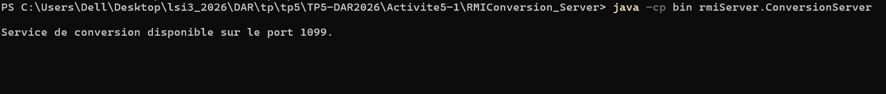
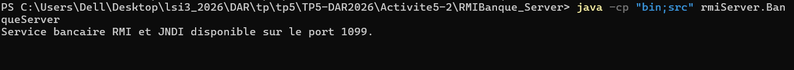

# TP5 – Java RMI et JNDI

**Faculté des Sciences de Sfax (FSS)**  
**Département d'Informatique et des Communications**  
**Filière :** LSI3  
**Année universitaire :** 2026-2027  
**Matière :** Développement d'Applications Réparties (DAR)  
**Responsable du cours :** Mme Amal ABID  
**Enseignante des TP :** Mme Zeineb DAOUD

## 1. Présentation

L'objectif de ce TP est de développer des applications réparties en Java en utilisant **RMI (Remote Method Invocation)**.

RMI permet à un programme client d'appeler une méthode appartenant à un objet distant, exécuté sur un serveur.

Le TP contient deux activités :

- **Activité 5-1 :** réalisation d'un service de conversion de devises avec Java RMI.
- **Activité 5-2 :** réalisation d'un service bancaire avec Java RMI, puis utilisation de JNDI pour enregistrer et rechercher l'objet distant.

Ces activités permettent de comprendre le fonctionnement des interfaces distantes, des objets RMI, du registre RMI, de la sérialisation et de JNDI.

## 2. Organisation du projet

Le TP est organisé en quatre projets Java séparés : un serveur et un client pour chaque activité.

```text
TP5-DAR2026/
│
├── Activite5-1/
│   ├── RMIConversion_Server/
│   │   └── src/
│   │       ├── rmiService/
│   │       │   ├── IConversion.java
│   │       │   └── ConversionImpl.java
│   │       └── rmiServer/
│   │           └── ConversionServer.java
│   │
│   └── RMIConversion_Client/
│       ├── src/
│       │   └── rmiClient/
│       │       └── ConversionClient.java
│       └── lib/
│           └── conversionClient.jar
│
├── Activite5-2/
│   ├── RMIBanque_Server/
│   │   └── src/
│   │       ├── metier/
│   │       │   └── Compte.java
│   │       ├── rmiService/
│   │       │   ├── IBanque.java
│   │       │   └── BanqueImpl.java
│   │       ├── rmiServer/
│   │       │   └── BanqueServer.java
│   │       └── jndi.properties
│   │
│   └── RMIBanque_Client/
│       ├── src/
│       │   ├── rmiClient/
│       │   │   └── BanqueClient.java
│       │   └── jndi.properties
│       └── lib/
│           └── banqueClient.jar
│
├── docs/
│   ├── screenshots/
│   └── test-results/
│
├── .gitignore
└── README.md
```

Les fichiers JAR sont générés à partir des classes nécessaires du serveur.

Le client utilise ces fichiers pour connaître les interfaces distantes, sans avoir accès aux classes qui implémentent les services.

## 3. Environnement de développement

Le projet a été réalisé avec :

- **Système d'exploitation :** Windows 11
- **Langage :** Java
- **JDK :** 21
- **Terminal :** Windows PowerShell
- **Gestion de versions :** Git et GitHub

Aucune bibliothèque externe n'est nécessaire.

Pour vérifier Java :

```powershell
java -version
javac -version
jar --version
```

Toutes les commandes suivantes doivent être exécutées depuis la racine du dossier `TP5-DAR2026`, sauf indication contraire.

## 4. Activité 5-1 : Service de conversion avec RMI

### 4.1. Objectif

Cette activité consiste à développer un serveur qui propose une méthode distante permettant de convertir un montant en euros vers le dinar tunisien.

Le client récupère la référence du service distant et appelle la méthode de conversion.

### 4.2. Développement du serveur

Le projet `RMIConversion_Server` contient trois classes principales.

**IConversion.java**

Il s'agit de l'interface distante qui étend `Remote` et déclare la méthode :

```java
double convertirMontant(double mt) throws RemoteException;
```

**ConversionImpl.java**

Cette classe implémente `IConversion` et réalise le calcul de conversion sur le serveur.

**ConversionServer.java**

Cette classe démarre le registre RMI sur le port `1099`, crée l'objet distant et le publie sous le nom `conversion`.

### 4.3. Développement du client

Le projet `RMIConversion_Client` contient la classe `ConversionClient.java`.

Le client recherche le service `conversion` dans le registre RMI, récupère sa référence et appelle :

```java
convertirMontant(500)
```

Le calcul est effectué sur le serveur. Le résultat est ensuite renvoyé au client.

### 4.4. Compilation

Dans PowerShell, depuis le dossier principal du TP5 :

```powershell
$s = 'Activite5-1/RMIConversion_Server'
$c = 'Activite5-1/RMIConversion_Client'

New-Item -ItemType Directory -Force "$s/bin", "$c/bin", "$c/lib" | Out-Null

javac -encoding UTF-8 -d "$s/bin" (Get-ChildItem "$s/src" -Recurse -Filter '*.java').FullName

jar cf "$c/lib/conversionClient.jar" -C "$s/bin" rmiService/IConversion.class

javac -encoding UTF-8 -cp "$c/lib/conversionClient.jar" -d "$c/bin" (Get-ChildItem "$c/src" -Recurse -Filter '*.java').FullName
```

### 4.5. Exécution

**Terminal 1 : serveur**

```powershell
java -cp 'Activite5-1/RMIConversion_Server/bin' rmiServer.ConversionServer
```

**Terminal 2 : client**

```powershell
java -cp 'Activite5-1/RMIConversion_Client/bin;Activite5-1/RMIConversion_Client/lib/conversionClient.jar' rmiClient.ConversionClient
```

Il faut lancer le serveur avant le client.

### 4.6. Résultat du test

Le taux utilisé dans l'exemple pédagogique du cours de Mme Amal ABID est :

**1 euro = 3 dinars**

Ce taux est fixe et sert uniquement à tester le fonctionnement de l'application. Il ne représente pas le taux de change réel.

Le client invoque la méthode distante avec le montant `500`.

Le résultat obtenu est :

```text
Montant en euros : 500
Montant converti en dinars : 1500.0
```

L'appel distant a fonctionné correctement.

Un autre test a été effectué sans démarrer le serveur. Dans ce cas, le client affiche une erreur de connexion, ce qui confirme que le service distant doit être disponible pour recevoir les appels.

### 4.7. Vérification du fichier JAR

Le fichier `conversionClient.jar` contient uniquement l'interface distante nécessaire au client.

Commande de vérification :

```powershell
jar tf "Activite5-1/RMIConversion_Client/lib/conversionClient.jar"
```

Résultat :

```text
META-INF/
META-INF/MANIFEST.MF
rmiService/IConversion.class
```

Les classes `ConversionImpl` et `ConversionServer` ne sont pas incluses dans ce JAR.

### 4.8. Captures d'écran

**Serveur RMI :** démarrage du serveur et publication du service de conversion.



**Client RMI :** appel de `convertirMontant(500)` et affichage du résultat.


**Fichier JAR :** vérification du contenu de `conversionClient.jar`.


---

## 5. Activité 5-2 : Service bancaire avec RMI

### 5.1. Objectif

Cette activité consiste à développer une application répartie permettant de gérer des comptes bancaires.

Le serveur propose deux services :

- Créer un nouveau compte bancaire.
- Consulter les informations d'un compte existant.

Chaque compte possède :

- Un code de type `int`.
- Un solde de type `double`.
- Une date de création de type `Date`.

### 5.2. Classe Compte

Dans le package `metier`, la classe `Compte` implémente l'interface `Serializable`.

Cela permet de transférer les objets `Compte` entre le client et le serveur à travers RMI.

La classe contient les informations du compte et les méthodes nécessaires pour les consulter.

### 5.3. Interface distante IBanque

L'interface `IBanque` se trouve dans le package `rmiService`.

Elle étend `Remote` et déclare les méthodes suivantes :

```java
String creerCompte(Compte c) throws RemoteException;

String getInfoCompte(int code) throws RemoteException;
```

La première méthode permet de créer un compte.

La deuxième permet de consulter un compte à partir de son code.

### 5.4. Implémentation BanqueImpl

La classe `BanqueImpl` implémente l'interface `IBanque`.

Les comptes sont enregistrés dans une `Map` en mémoire.

Lorsqu'un client demande la création d'un compte, le serveur vérifie si son code existe déjà.

- Si le code est nouveau, le compte est créé.
- Si le code existe, le serveur refuse la création.

Pour la consultation :

- Si le compte existe, le serveur retourne ses informations.
- Sinon, il retourne un message indiquant que le compte est introuvable.

Les méthodes de gestion sont `synchronized` pour protéger les accès lorsque plusieurs clients utilisent le service.

**Remarque :** les comptes sont conservés uniquement en mémoire. Ils sont perdus lorsque le serveur s'arrête. Aucune base de données n'est utilisée dans ce TP.

### 5.5. Développement du client

La classe `BanqueClient` utilise le service distant `IBanque`.

Le client effectue les opérations suivantes :

1. Créer un compte portant le code `101` avec un solde initial de `1000.0`.
2. Consulter le compte `101`.
3. Essayer de recréer le compte `101`.
4. Consulter un compte inexistant portant le code `999`.

Ces opérations permettent de vérifier le fonctionnement normal du service et la gestion de deux cas particuliers.

### 5.6. Vérification avec RMI direct

La première version de l'activité bancaire utilisait directement le registre RMI avec :

```java
Registry.rebind()
Registry.lookup()
```

Cette version a été compilée et testée avant le passage à JNDI.

Les tests ont confirmé :

- La création du compte `101`.
- La consultation du compte `101`.
- Le refus d'un compte portant un code déjà utilisé.
- Le message de compte introuvable pour le code `999`.

Les sorties des tests sont conservées dans `docs/test-results/`.

---

## 6. Utilisation de JNDI

### 6.1. Présentation

Dans la dernière étape de l'activité 5-2, l'application bancaire est modifiée pour utiliser **JNDI (Java Naming and Directory Interface)**.

JNDI permet d'enregistrer et de rechercher des objets distants à travers une interface d'annuaire.

Dans ce TP, JNDI utilise le registre RMI comme service d'annuaire.

### 6.2. Configuration

Les projets serveur et client possèdent chacun un fichier `jndi.properties`.

Son contenu est :

```properties
java.naming.factory.initial=com.sun.jndi.rmi.registry.RegistryContextFactory
java.naming.provider.url=rmi://localhost:1099
```

La première propriété indique la fabrique de contexte utilisée.

La deuxième indique l'adresse du registre RMI.

Lors de la compilation, le fichier est copié dans le dossier `bin` afin d'être disponible dans le classpath.

### 6.3. Modification du serveur

Dans la version finale, `BanqueServer` utilise :

```java
InitialContext.rebind()
```

Cette méthode permet d'enregistrer l'objet distant dans l'annuaire à travers JNDI.

Le registre RMI est toujours créé sur le port `1099`, mais l'enregistrement du service passe maintenant par JNDI.

Le service bancaire est publié sous le nom `banque`.

### 6.4. Modification du client

Dans `BanqueClient`, la recherche de l'objet distant utilise :

```java
InitialContext.lookup()
```

Le client retrouve le service `banque`, puis appelle les méthodes de l'interface `IBanque`.

L'utilisation de JNDI ne change pas les opérations proposées par le serveur. Elle change la manière de publier et de rechercher le service.

### 6.5. Compilation de l'activité 5-2

Dans PowerShell, depuis la racine du TP5 :

```powershell
$s = 'Activite5-2/RMIBanque_Server'
$c = 'Activite5-2/RMIBanque_Client'

New-Item -ItemType Directory -Force "$s/bin", "$c/bin", "$c/lib" | Out-Null

javac -encoding UTF-8 -d "$s/bin" (Get-ChildItem "$s/src" -Recurse -Filter '*.java').FullName

Copy-Item "$s/src/jndi.properties" "$s/bin/jndi.properties"

jar cf "$c/lib/banqueClient.jar" -C "$s/bin" rmiService/IBanque.class -C "$s/bin" metier/Compte.class

javac -encoding UTF-8 -cp "$c/lib/banqueClient.jar" -d "$c/bin" (Get-ChildItem "$c/src" -Recurse -Filter '*.java').FullName

Copy-Item "$c/src/jndi.properties" "$c/bin/jndi.properties"
```

### 6.6. Exécution de l'application bancaire

Avant de lancer le serveur bancaire, arrêter le serveur de conversion avec `Ctrl + C`, car les deux applications utilisent le port `1099`.

**Terminal 1 : serveur bancaire**

```powershell
java -cp 'Activite5-2/RMIBanque_Server/bin' rmiServer.BanqueServer
```

**Terminal 2 : client bancaire**

```powershell
java -cp 'Activite5-2/RMIBanque_Client/bin;Activite5-2/RMIBanque_Client/lib/banqueClient.jar' rmiClient.BanqueClient
```

Le serveur doit rester actif pendant l'exécution du client.

### 6.7. Résultats des tests JNDI

Après la modification de l'application pour utiliser JNDI, les mêmes opérations bancaires ont été testées.

| Test | Résultat |
|---|---|
| Création du compte 101 | Réussie |
| Consultation du compte 101 | Informations retournées |
| Création d'un doublon 101 | Refusée |
| Consultation du compte 999 | Compte introuvable |

Les tests ont également confirmé que le serveur restait actif après les appels du client.

Le fonctionnement du service bancaire a donc été conservé après le passage de RMI direct à JNDI.

### 6.8. Vérification du fichier banqueClient.jar

Le projet client utilise le fichier `banqueClient.jar`.

Pour vérifier son contenu :

```powershell
jar tf "Activite5-2/RMIBanque_Client/lib/banqueClient.jar"
```

Résultat :

```text
META-INF/
META-INF/MANIFEST.MF
metier/Compte.class
rmiService/IBanque.class
```

Ce fichier contient uniquement l'interface distante et la classe sérialisable nécessaires au client.

Les classes `BanqueImpl` et `BanqueServer` restent dans le projet serveur.

**Remarque :** dans l'énoncé officiel de l'activité 5-2, une instruction d'import mentionne `conversionClient.jar`. Le fichier correspondant au projet bancaire est bien `banqueClient.jar`.

### 6.9. Captures d'écran

**Serveur bancaire :** démarrage et enregistrement du service avec JNDI.



**Client bancaire :** création et consultation des comptes en utilisant les méthodes distantes.


**Fichier JAR :** vérification du contenu de `banqueClient.jar`.


---

## 7. Récapitulatif des tests

Les tests ont été réalisés avec JDK 21 sur Windows 11.

| Vérification | Résultat |
|---|---|
| Compilation de RMIConversion_Server | Réussie |
| Compilation de RMIConversion_Client | Réussie |
| Compilation de RMIBanque_Server | Réussie |
| Compilation de RMIBanque_Client | Réussie |
| Export de conversionClient.jar | Réussi |
| Export de banqueClient.jar | Réussi |
| Conversion de 500 euros | 1500.0 dinars |
| Connexion sans serveur RMI | Erreur de connexion affichée |
| Création d'un compte bancaire | Réussie |
| Consultation d'un compte | Réussie |
| Refus d'un compte déjà existant | Réussi |
| Consultation d'un compte inexistant | Message approprié |
| Enregistrement du service avec JNDI | Réussi |
| Recherche du service avec JNDI | Réussie |

Les résultats des essais effectués sont enregistrés dans le dossier :

`docs/test-results/`

Les captures d'écran des exécutions et du contenu des fichiers JAR sont disponibles dans :

`docs/screenshots/`

## 8. Synthèse

Ce TP m'a permis de comprendre comment créer une application répartie en utilisant Java RMI.

Dans la première activité, j'ai appris à définir une interface distante, à implémenter un service sur le serveur et à invoquer une méthode depuis un client.

Dans la deuxième activité, j'ai utilisé la sérialisation pour transférer un objet `Compte` entre deux JVM. J'ai également appris à gérer plusieurs comptes sur un serveur et à vérifier les cas où un compte existe déjà ou n'existe pas.

Enfin, l'utilisation de JNDI m'a permis de comprendre une autre méthode pour enregistrer et rechercher les objets distants dans un annuaire RMI.

La différence principale avec les TP précédents sur les sockets est qu'avec RMI, le client peut appeler directement une méthode distante sans gérer lui-même l'envoi et la réception des messages réseau.

## 9. Dépôt du projet

Le projet est préparé sous le nom :

**TP5-DAR2026**

Il contient les quatre projets Java, les fichiers JAR nécessaires aux clients, les fichiers de configuration JNDI, les résultats des tests et les captures d'écran.

