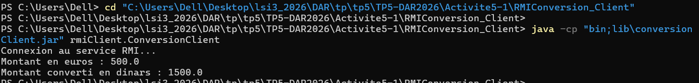
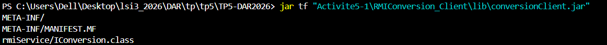
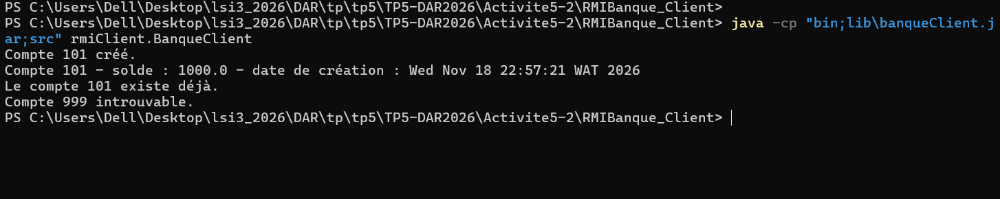
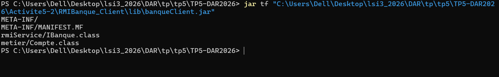

# TP5 - Java RMI

## Objectif

Appeler depuis un client des méthodes exécutées sur un serveur Java. La deuxième activité utilise aussi JNDI pour retrouver le service.

## Exercices réalisés

- Activité 5-1 : conversion d'un montant en euros vers des dinars avec RMI.
- Activité 5-2 : création et consultation de comptes bancaires avec RMI et JNDI.

## Lancement

Dans PowerShell, depuis `TP5-DAR2026`, compiler l'activité 5-1 :

```powershell
$s = 'Activite5-1/RMIConversion_Server'
$c = 'Activite5-1/RMIConversion_Client'
New-Item -ItemType Directory -Force "$s/bin", "$c/bin" | Out-Null
javac -encoding UTF-8 -d "$s/bin" (Get-ChildItem "$s/src" -Recurse -Filter '*.java').FullName
javac -encoding UTF-8 -cp "$c/lib/conversionClient.jar" -d "$c/bin" (Get-ChildItem "$c/src" -Recurse -Filter '*.java').FullName
```

Dans deux terminaux ouverts dans ce dossier, lancer le serveur puis le client :

```powershell
java -cp 'Activite5-1/RMIConversion_Server/bin' rmiServer.ConversionServer
java -cp 'Activite5-1/RMIConversion_Client/bin;Activite5-1/RMIConversion_Client/lib/conversionClient.jar' rmiClient.ConversionClient
```

Pour l'activité 5-2, arrêter d'abord le serveur de conversion, car les deux serveurs utilisent le port `1099`. Compiler puis lancer :

```powershell
$s = 'Activite5-2/RMIBanque_Server'
$c = 'Activite5-2/RMIBanque_Client'
New-Item -ItemType Directory -Force "$s/bin", "$c/bin" | Out-Null
javac -encoding UTF-8 -d "$s/bin" (Get-ChildItem "$s/src" -Recurse -Filter '*.java').FullName
Copy-Item "$s/src/jndi.properties" "$s/bin/jndi.properties"
javac -encoding UTF-8 -cp "$c/lib/banqueClient.jar" -d "$c/bin" (Get-ChildItem "$c/src" -Recurse -Filter '*.java').FullName
Copy-Item "$c/src/jndi.properties" "$c/bin/jndi.properties"
```

```powershell
java -cp 'Activite5-2/RMIBanque_Server/bin' rmiServer.BanqueServer
java -cp 'Activite5-2/RMIBanque_Client/bin;Activite5-2/RMIBanque_Client/lib/banqueClient.jar' rmiClient.BanqueClient
```

## Captures










